# 🌍 Trekio – AI-Powered Trip Planner

Trekio is a smart AI travel iternary planning app that uses **Gemini Flash 2.0** to generate personalized trip plans. Input your destination, dates, budget, and number of travelers—Trekio does the rest!

---

## 🚀 Features

- 🔍 **Location Autocomplete** using Google Places API
- 🤖 **AI-Generated Trip Plan** from Gemini Flash 2.0
  - ✈️ Flights
  - 🏨 Hotels
  - 📅 Day-by-Day Planner
- 🔐 **Firebase Authentication**
- ☁️ **Firestore for data storage**
- 🎞️ **Lottie animations** for an engaging UI

---

## 🛠 Tech Stack

- **Frontend**: React Native with Expo
- **AI API**: Gemini Flash 2.0 (Google)
- **Backend**: Firebase Functions
- **Database**: Firestore
- **Location Search**: Google Places API
- **Animations**: Lottie

---

## 📱 Screenshots

Below are some preview images from the app. All UI screens including onboarding, planner, hotel/flight recommendations, and final itinerary are shown.

> 🖼️ Images are stored in the `Trekio images/` folder.

## 🖼️ App Screenshots

Below are the screenshots demonstrating the complete functionality of Trekio – from onboarding to AI-generated itinerary.

<h2>📱 App Screenshots</h2>

  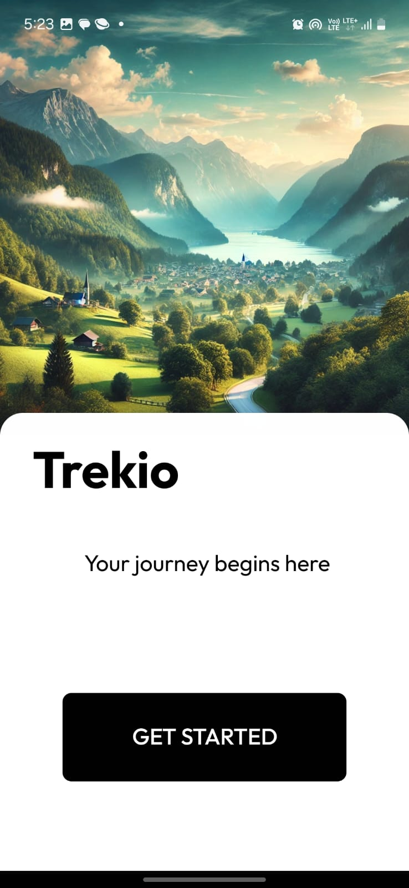
  
  

  
  
  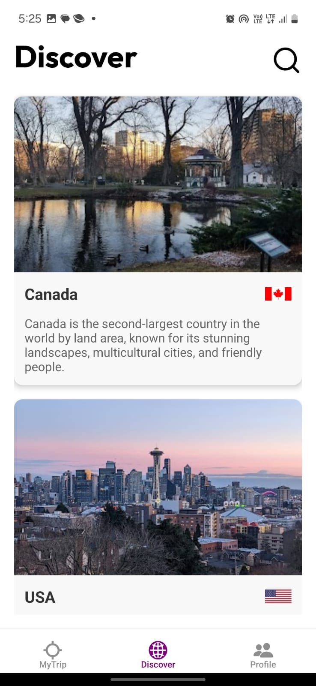

  
  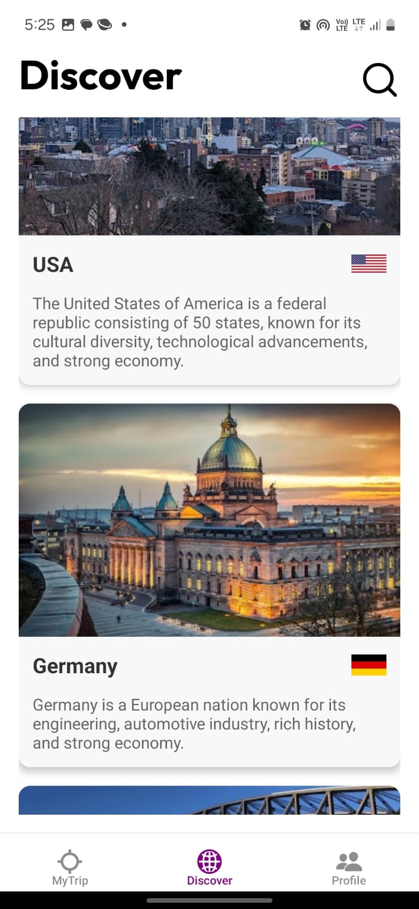
  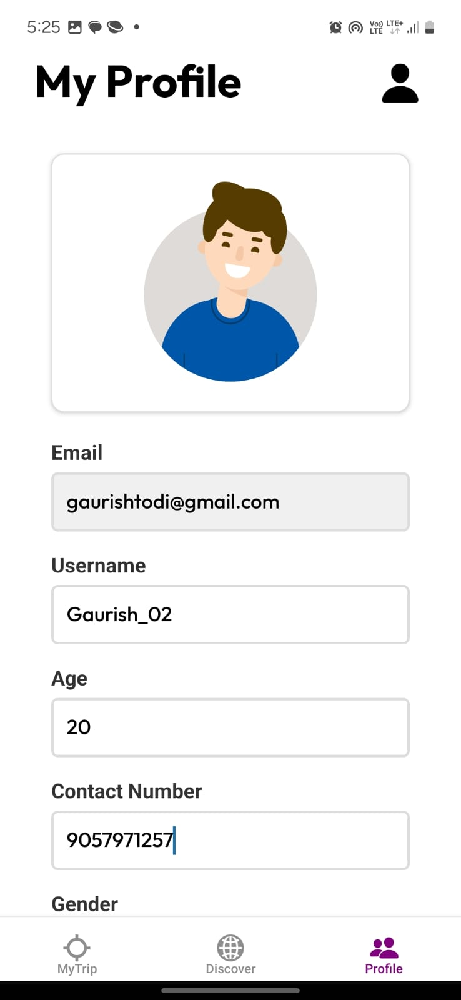

  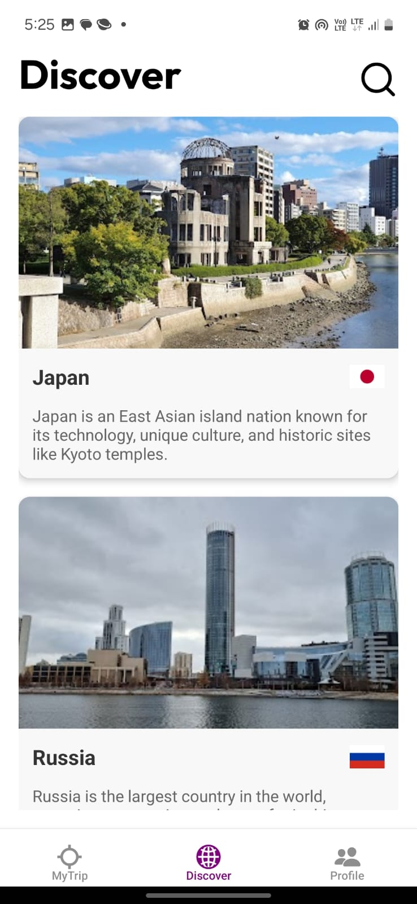
  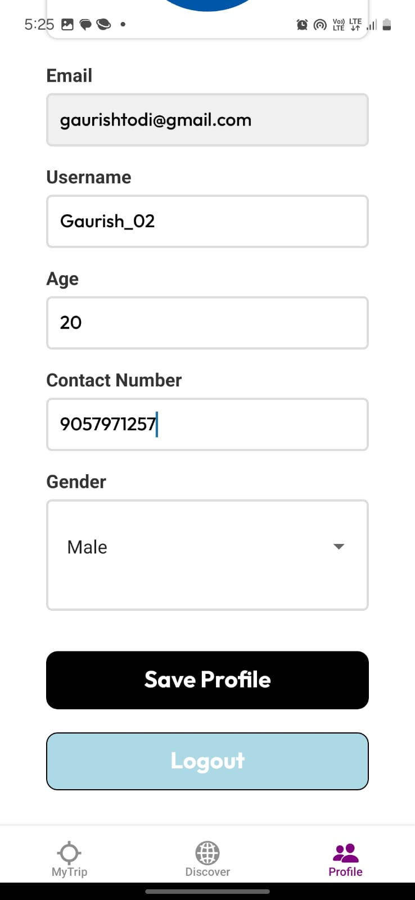
  

  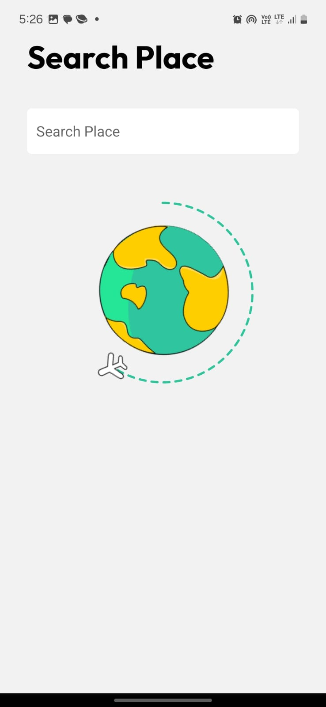
  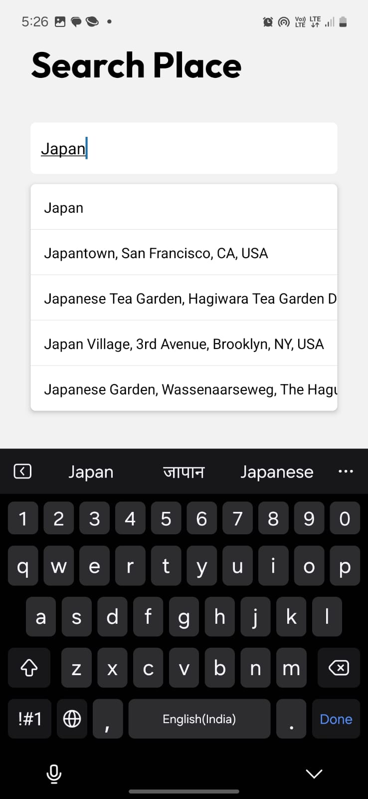
  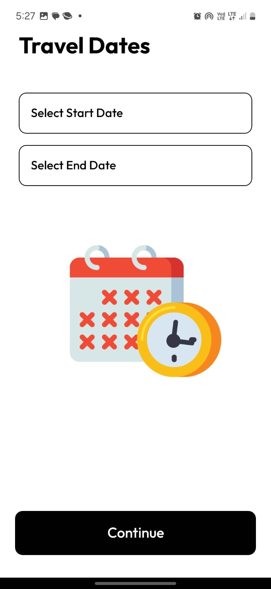

  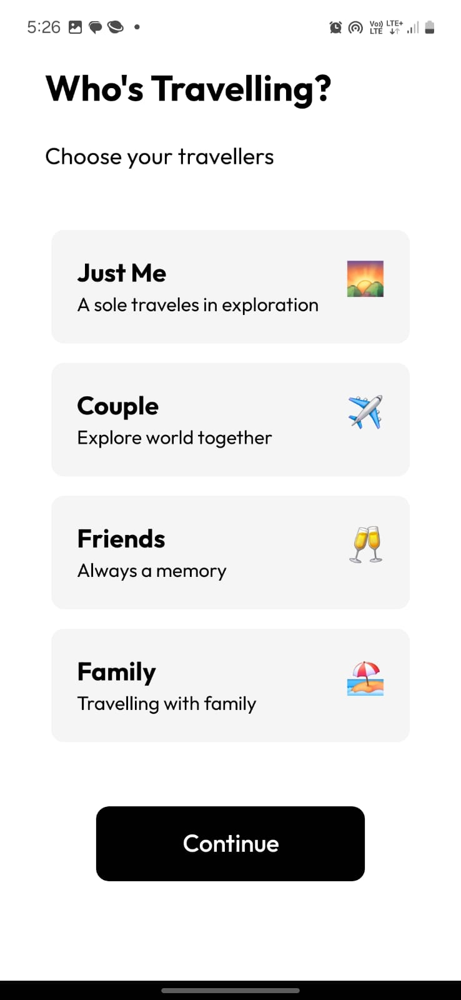
  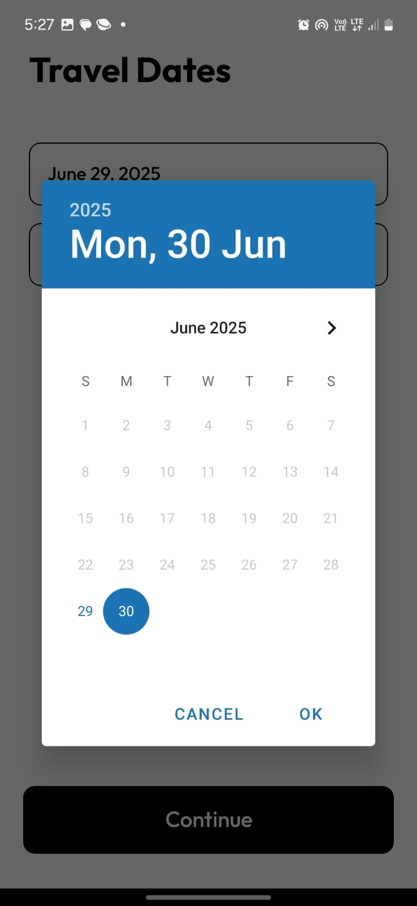
  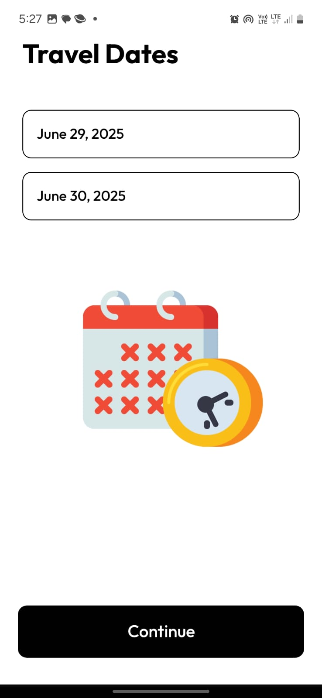

  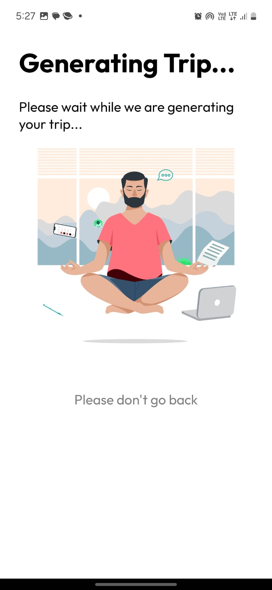
  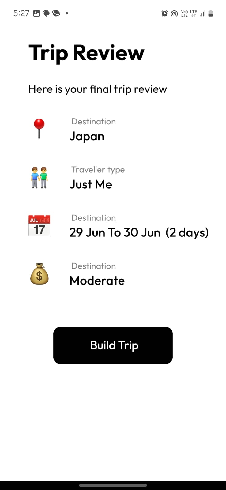
  

  
  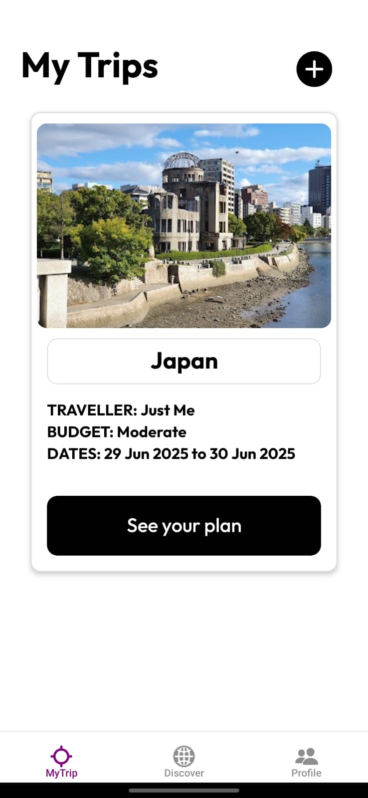
  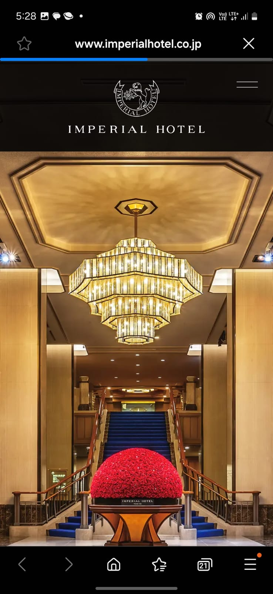

  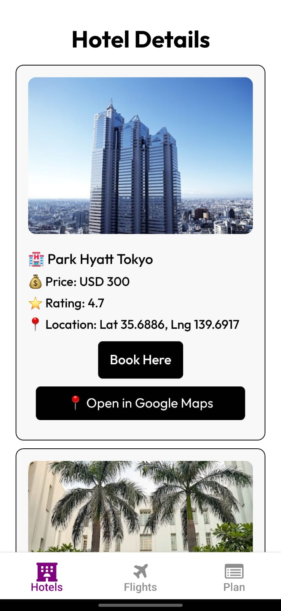
  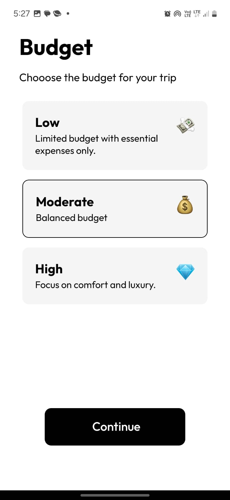
  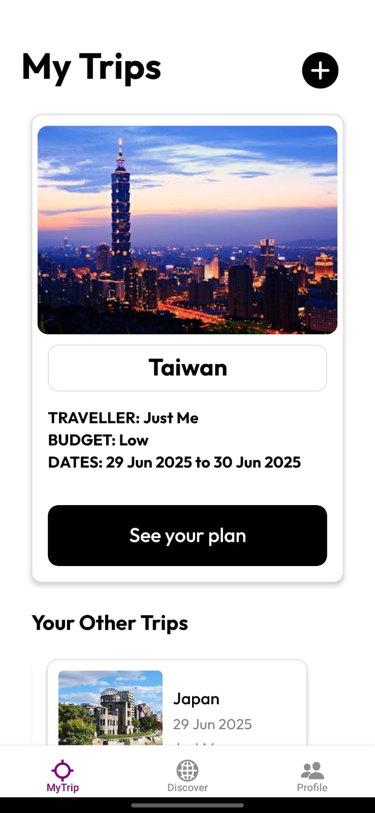

